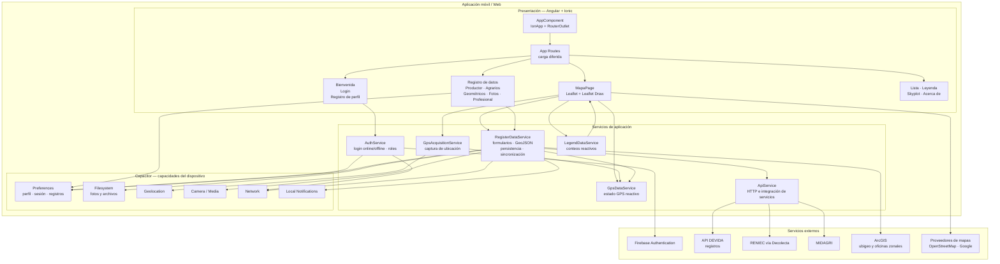

# Arquitectura de GeoDAIS Móvil

## Diagrama general

## Capas y responsabilidades

- **Presentación:** `AppComponent` contiene el `IonRouterOutlet`. Las rutas Angular cargan las páginas bajo demanda. `MapaPage` muestra el mapa y coordina la navegación a las pestañas de captura.
- **Servicios de aplicación:** gestionan autenticación, formularios y registros, ubicación GPS, estado de la leyenda e integración HTTP. `RegisterDataService` comparte el estado del registro mediante `BehaviorSubject` y gestiona registros locales y pendientes de sincronización.
- **Plataforma móvil:** Capacitor proporciona almacenamiento (`Preferences`), archivos (`Filesystem`), cámara, geolocalización, conectividad y notificaciones. La aplicación también puede ejecutarse en navegador, aunque ciertas capacidades dependen de la plataforma.
- **Servicios externos:** Firebase Authentication para el acceso conectado; API DEVIDA para envío de registros; Decolecta/RENIEC y MIDAGRI para consultas de datos; ArcGIS para referencias geográficas; OpenStreetMap y Google para capas cartográficas.

## Flujos principales

1. **Acceso:** `LoginPage` delega en `AuthService`. Con conexión usa Firebase Authentication y guarda los datos necesarios para el modo sin conexión en `Preferences`; sin conexión valida contra ese almacenamiento local.
2. **Captura geográfica:** `GpsAcquisitionService` obtiene posiciones mediante Capacitor Geolocation y las publica en `GpsDataService`. En la captura de fotos y puntos del mapa reutiliza una lectura reciente cuando cumple el umbral horizontal; si el seguimiento GPS ya está activo, espera nuevas muestras en ese mismo seguimiento en lugar de abrir otro. La adquisición tiene un máximo de 5 segundos, puede terminar antes al alcanzar precisión alta y selecciona por separado las mejores lecturas horizontal y vertical. La precisión vertical permanece como no disponible cuando el dispositivo no la reporta.
3. **Registro y sincronización:** las pestañas de captura alimentan `RegisterDataService`. Los datos y archivos se guardan localmente; cuando se recupera la conexión, los registros pendientes se envían mediante `ApiService` a la API DEVIDA.
4. **Mapa:** `MapaPage` usa Leaflet y Leaflet Draw para la visualización y edición de geometrías y obtiene las teselas de los proveedores configurados.
